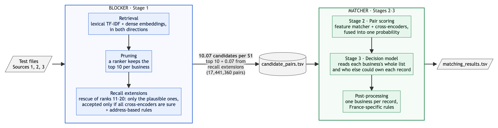

# Amazon ML Challenge 2026: Business Entity Resolution

Team **The Global Optima**. The task is to match noisy business records from Sources 2 and 3 (about 5M each) to a
deduplicated reference of 1.7M businesses (Source 1), across the US, India and France.

## Result
- Public leaderboard: AIR 56, F0.5 **0.990273**
- US/India holdout: F0.5 **0.9913**

## The problem
- Metric: F0.5 (precision counts twice as much as recall), macro-averaged per Source 1 business. A false match on a
  business that has no true match scores 0 for that business.
- France appears only in the test set and has no training labels.
- No external data, APIs or lookups. Models must have at most 8B parameters and an MIT or Apache-2.0 licence.

## Pipeline

- The **blocker** (Stage 1) turns the test files into `candidate_pairs.tsv`: about 10 candidates per business, with
  99.3% recall.
- The **matcher** (Stages 2–3 and post-processing) decides which candidates are the same business and writes
  `matching_results.tsv`.
- Everything runs within each country. France gets an adapted Stage 3 model and label-backed rules.

| Stage | What it does |
|---|---|
| **1 · Retrieval** | Character TF-IDF on name and address, a reverse search from each record to its likely businesses, and a fine-tuned multilingual-e5 model searched in both directions. About 290 candidates per business, 99.88% recall. |
| **1 · Pruning** | An XGBoost ranker on retrieval signals keeps the top 10 per business (99.32% recall). |
| **1 · Recall extensions** | Ranks 11–20 are rescued only when all three cross-encoders are near-certain and no other business holds the record. Address-based rules add records at a business's own address that retrieval missed. |
| **2 · Pair scoring** | An XGBoost feature matcher and three mDeBERTa-v3 cross-encoders, fused into one probability by a second XGBoost model with decoys up-weighted. |
| **3 · Decision model** | An XGBoost model over each business's whole candidate list, with global context (name and address frequency, reverse competition, house numbers, record ownership). Averaged over 5 seeds; picks the top-k that maximises expected F0.5. |
| **3 · France** | The same model without the inputs that shift in France, self-trained on rule-labelled French test pairs (no test labels used). |
| **Post-processing** | One business per record, plus France rules at the business's own address. |

## Validation
- 100k training businesses (50k US, 50k India) are split by ID hash into train, dev and holdout. Rules and thresholds
  are chosen on dev, and holdout is scored once. The embedding model and cross-encoders never see these 100k.
- Before every upload: a train-versus-test transfer check, France sanity checks, and the official validator with
  `--check-ids`.
- A France rule is used only when its pattern is well above the F0.5 break-even on the US/India training labels, and
  after a hand-check of random French samples.

## Models

| Model | Parameters | Licence | Used for |
|---|---|---|---|
| mDeBERTa-v3-base | 278M | MIT | Stage 2 cross-encoders |
| multilingual-e5-small (fine-tuned) | 118M | MIT | Stage 1 retrieval; Stage 3 reverse competition |
| XGBoost | — | Apache-2.0 | pruner, feature matcher, fusion, Stage 3 |
| Qwen2.5-7B-Instruct + LoRA | 7.6B | Apache-2.0 | confirming French decoy drops only |

Full architecture, script map and code names: [docs/ARCHITECTURE.md](docs/ARCHITECTURE.md).
Final code and run instructions:
[submissions/The_Global_Optima_submission/code/business_entity_resolution/](submissions/The_Global_Optima_submission/code/business_entity_resolution/).

## Timeline
- Round 1: 25 Sept 2026 - 28 Sept 2026 (72 hours, dataset drops Day 1)
- Grand Finale: 7 Oct 2026 (top 10 teams)

## Structure
- `data/raw/` - original dataset, untouched
- `data/processed/` - cleaned/feature-engineered data
- `data/external/` - any external data used
- `notebooks/` - EDA and experiments
- `src/` - reusable pipeline code (preprocessing, features, models, eval)
- `models/` - saved model artifacts
- `submissions/` - generated submission files; the final package is `submissions/The_Global_Optima_submission/`
- `references/` - problem statement, rules, scoring docs
- `docs/` - architecture, pipeline flowchart, submission tracker and reports
