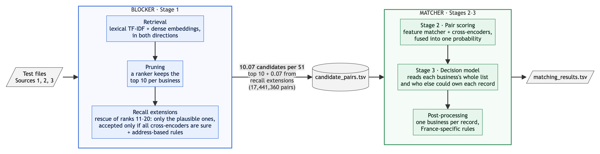

# Architecture: Business Entity Resolution (Team The Global Optima)

A one-page map of the system: what each stage does and which scripts implement it. The method and results are in
`Documentation_template.md` at the root of the package. Step-by-step run instructions are in `README.md`.

**Final submission:** public leaderboard F0.5 **0.990273**; US/India holdout F0.5 **0.9913**.

## 1. Pipeline

- The **blocker** (Stage 1) turns the test files into `output/candidate_pairs.tsv`: about 10 candidates per business,
  with 99.3% recall.
- The **matcher** (Stages 2–3 and post-processing) decides which candidates are the same business and writes
  `output/matching_results.tsv`.
- Everything runs within each country. France has no training labels, so it gets an adapted Stage 3 model and
  label-backed rules.
- The chart's source is `pipeline_flowchart.mmd` (Mermaid).

## 2. Stages

| Stage | What it does | Main scripts |
|---|---|---|
| **1 · Retrieval** | Character TF-IDF on name and address, a reverse search from each record to its likely businesses, and a fine-tuned multilingual-e5 model searched in both directions. About 290 candidates per business, 99.88% recall. | `stage1_blocking/`: `preprocess.py`, `posting_index.py`, `reverse_index.py`, `dense_retrieval.py` |
| **1 · Pruning** | An XGBoost ranker on retrieval signals only keeps the top 10 per business (99.32% recall). | `stage1_blocking/prune_analysis.py`; `core/submission_pipeline.py predict` |
| **1 · Recall extensions** | **Rescue of ranks 11–20:** the ranks 11–20 that a light matcher finds plausible become candidates, and are accepted only when all three cross-encoders are near-certain and no other business holds the record. **Address-based rules:** records at a business's own address that retrieval missed (invented names, initials, aliases). | `stage1_blocking/rescue_11_20.py`, `u9_build.py` |
| **2 · Pair scoring** | An XGBoost feature matcher and three mDeBERTa-v3 cross-encoders, fused into one probability by a second XGBoost model with decoys up-weighted. | `core/submission_pipeline.py` (feature matcher); `stage2_pair_scoring/` |
| **3 · Decision model** | An XGBoost model over each business's whole candidate list, with global context: name and address frequency, reverse competition, house numbers, record ownership and rival copies. Averaged over 5 seeds; picks the top-k that maximises expected F0.5. | `stage3_decision/` |
| **3 · France** | The same model without the inputs that shift in France, self-trained on rule-labelled French test pairs (no test labels used). | `stage3_france/` |
| **Post-processing** | One business per record, and France rules at the business's own address (add legal-form, filler, alias and initials variants; drop business-type swaps and affiliate words). | `core/submission_pipeline.py` (`finalize`); `postprocessing/` (incl. `synthetic_alias/`) |

All paths are under `src/`.

## 3. How it was validated

- 100k training businesses (50k US, 50k India) are split by ID hash into train, dev and holdout. Models train on
  train, rules and thresholds are chosen on dev, and holdout is scored once. The embedding model and cross-encoders
  never see these 100k.
- Before any upload:
  - a train-versus-test transfer check on the models' outputs;
  - France sanity checks (links per business, share of empty rows);
  - the official validator with `--check-ids`.
- A France rule is used only when its pattern is well above the F0.5 break-even on the full US/India training labels
  (the generator uses the same recipes in every country), and after a hand-check on random French samples.

## 4. Names used in the code

| This document | In the code |
|---|---|
| Stage 1 pruning | stage-1 (`prune_v1`) |
| Stage 2 feature matcher | v5 matcher |
| Stage 2 cross-encoders | chunk2, full21, decoyw2 |
| Stage 2 fusion | L2 late fusion |
| Stage 3 decision model | stage-3b; final model T6; 5-seed average = T6 bag |
| Stage 3 for France | FRrobust, FRtrained_w4 |
| Same-address France rules | census (v2) |
| France post-processing rules | U6–U19 (named after the submission that added them) |

## 5. Models and licences

| Model | Parameters | Licence | Used for |
|---|---|---|---|
| mDeBERTa-v3-base | 278M | MIT | Stage 2 cross-encoders |
| multilingual-e5-small (fine-tuned) | 118M | MIT | Stage 1 retrieval; Stage 3 reverse competition |
| XGBoost | — | Apache-2.0 | pruner, feature matcher, fusion, Stage 3 |
| Qwen2.5-7B-Instruct + LoRA | 7.6B | Apache-2.0 | confirming French decoy drops only |

No external data, APIs or lookups are used. Pretrained checkpoints were downloaded once.
