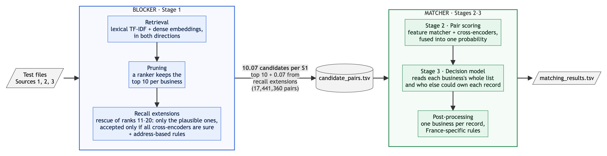

# ML Challenge 2026: Business Entity Resolution Solution Template

**Team Name:** The Global Optima
**Team Members:** Ayush Srivastava, Tapan Patel, Vishal Singh
**Submission Date:** 27 September 2026

---

## 1. Executive Summary

We treat the task as retrieval followed by a list-level decision. A hybrid blocker (character TF-IDF, reverse
search and a fine-tuned multilingual embedding model) keeps about 10 candidates per business at 99.3% recall. A
feature matcher and transformer cross-encoders score every pair, and a decision model picks the matches by reading
each business's whole candidate list together with who else could own each record. The key idea is **record
ownership**: a record belongs to at most one business, so a match is accepted only when this business is the
record's clearly best owner. France, which has no training labels, gets an adapted model and rules whose precision
is measured on the US/India labels.

**Results:** macro F0.5 **0.9913** on our US/India holdout; **0.990273** on the public leaderboard.

---

## 2. Methodology

### 2.1 Problem Analysis

- **Scale.** Train has 2.21M Source 1 businesses and 10.32M Source 2/3 records; test has 1.73M and 9.97M. Comparing
  all pairs is impossible, so blocking recall caps the score.
- **One owner per record.** No record is linked to more than one business, so matching is close to an assignment
  problem. A business has 0–4 copies in each of Sources 2 and 3, and 5.6% have none.
- **Decoys.** Many Source 2/3 records belong to no business: about 26% in train and an estimated 42% in test. They
  follow recipes: a house number shifted by a few, a business-type word swapped at the same address, or a legal form
  or affiliate word added ("Group", "Holdings").
- **Blank addresses.** 27% of candidate records have no address, so only the name can decide *which* same-name
  business owns them.
- **Name noise.** Case and punctuation changes, typos, abbreviations, legal-suffix changes, reordered or dropped
  words, web domains (`wilfordhancock.com`), junk prefixes, Indic scripts alongside Latin, and invented alias names
  at the business's own address.
- **France** appears only in test, with French legal forms (SARL, SAS), filler words ("& Fils", "Groupe") and French
  address formats. Models trained on US/India data behave measurably differently there.
- **Metric.** F0.5 weights precision twice as much as recall, and a business with no match scores 1 only when
  nothing is predicted. Decisions must be calibrated and conservative.

### 2.2 Solution Strategy

**Approach Type:** Hybrid: blocking → pair classifier → list-level decision model → rule-based post-processing.

**Core Innovation:** Deciding matches as **record ownership**. For every candidate record we compute, label-free and
identically on train and test, how well it fits this business compared with every other business that could own it
(reverse search over the full Source 1 table, name and address multiplicities, fuzzy name and address margins). The
decision model accepts a record only when this business is its clearly best owner.

**Evaluation protocol.**
- 100,000 training businesses (50k US, 50k India) are split by a hash of the ID into train, dev (15%) and holdout
  (15%). Models train on the train split, rules and thresholds are chosen on dev, and holdout is scored once per
  configuration.
- The embedding model and the cross-encoders are trained only on training businesses outside this sample.
- Macro F0.5 counts every business, including true links that blocking missed and businesses with no match.

---

## 3. Candidate Generation (Blocking)

Blocking (Stage 1) is label-free and runs within each country. Country is an open set, so France needs no special
handling.

- **Blocking keys used:**
  1. **Retrieval.**
     - *Lexical index:* character 3–5-gram TF-IDF on the name, the address, the house number with its neighbouring
       street words, and name + address together. Indic scripts are transliterated to Latin offline, and the routes
       are merged by reciprocal-rank fusion.
     - *Reverse search:* every Source 2/3 record queries an index of Source 1. A record that clearly points to a
       business becomes its candidate even when look-alikes crowd the business's own list.
     - *Dense retrieval:* `multilingual-e5-small`, fine-tuned contrastively on training pairs and searched exactly in
       both directions.
  2. **Pruning.** An XGBoost ranker on retrieval signals only (route scores and ranks, reverse ranks, embedding
     similarity) keeps the **top 10** candidates per business.
  3. **Recall extensions** (together about 0.7% more pairs).
     - *Rescue of ranks 11–20:* the ranks 11–20 that a light matcher finds plausible become candidates. They are
       accepted only when all three cross-encoders are near-certain and no other business holds the record.
     - *Address-based rules:* records at a business's own address that retrieval missed but address rules tie to
       exactly one business (invented names, initials, aliases).
- **Candidate pairs generated:** **17,441,360** (about 10 per business). `candidate_pairs.tsv` is exactly this set,
  and every final match is inside it.
- **How you ensured true matches were not lost:**

  | Candidate set (holdout) | Recall |
  |---|---:|
  | Lexical index | 94.57% |
  | + reverse search | 95.16% |
  | + dense retrieval (about 290 per business) | 99.88% |
  | **After pruning to the top 10** | **99.32%** |

  - The three retrieval sources are complementary; recall was re-measured on fixed samples after every change.
  - Keeping 20 candidates instead of 10 gained almost nothing downstream, so we kept the smaller set and added the
    targeted recall extensions instead.
  - Indic-script records are not a recall problem: they lose less at the top-10 cut than Latin records. Most
    blocking losses are true copies crowded out by many same-name businesses.

---

## 4. Matching Model

The matcher has two model stages and a post-processing step. Every model is trained on the train split and evaluated
on dev and holdout.

**Features used:**
- **Name features:** rapidfuzz ratio, token-sort, token-set and partial ratios on folded, legal-suffix-stripped,
  transliterated and phonetic names; Jaro-Winkler; exact and first-token match; length ratio; how common the name is
  across the dataset; legal-form and decoy-word flags.
- **Address features:** token-set and character similarity on folded and transliterated addresses; house-number and
  postal-code agreement, including numbers shifted by a few (a decoy recipe); empty-field flags; how many businesses
  share the address.
- **Other:**
  - retrieval scores and ranks, in both directions;
  - *list context:* each candidate's probability relative to the rest of the business's list, and how similar the
    candidates are to each other (true copies across sources are near-duplicates);
  - *ownership:* for every candidate record, the other businesses that could own it and how much better or worse they
    fit (name, address and raw-name margins, ties);
  - *rival copies:* how many same-name businesses exist and whether each already holds a clear copy.

**Model type:**
- **Stage 2: pair scoring.**
  - An XGBoost feature matcher.
  - Three `mDeBERTa-v3-base` cross-encoders that read both records as `name | address`. They are trained on up to
    21.2M labelled training pairs, on different samples; one up-weights decoys.
  - A fusion XGBoost model combines them into one probability, with decoy negatives up-weighted to match the higher
    decoy share in test.
- **Stage 3: decision model.** An XGBoost model over each business's whole candidate list, using all the context
  features above, averaged over 5 seeds.
- **France.** France has no labels, so Stage 3 is adapted:
  - inputs whose distribution shifts in France are removed;
  - the model is then self-trained on French test pairs pseudo-labelled by same-address rules and confident model
    predictions, with a country flag so US/India decisions are unchanged;
  - *Disclosure:* this is transductive self-training on unlabelled test inputs. No test labels and no external data
    are used.
- **Post-processing.**
  - *Exclusivity:* each record keeps only its most probable business. French records claimed by several businesses at
    near-equal probability are dropped.
  - *France rules:* at a business's own address, add records that are a legal-form or filler variant, an invented
    alias or the business's initials; reject records that swap the business type or add an affiliate word. The data
    generator uses the same recipes in every country, so a rule is used only when its pattern is well above the F0.5
    break-even (typically 95–100% true) on the full US/India training labels. Each rule was also hand-checked on
    random French samples. A LoRA-tuned Qwen2.5-7B judge is used only to confirm some French decoy drops.

**Threshold selection method:** chosen on dev by macro F0.5. For each business we take the top-k candidates that
maximise expected F0.5 given the calibrated probabilities, with a probability floor (0.68 for the final model). A
stricter check that counts decoy false matches twice chooses the same rule.

---

## 5. Results & Error Analysis

- **F_0.5 Score (macro):** **0.99128** on the holdout (15,113 US and India businesses); **0.990273** on the public
  leaderboard (final submission).

  | Configuration | Holdout F0.5 |
  |---|---:|
  | Blocking + feature matcher | 0.9731 |
  | + cross-encoder and fusion | 0.9862 |
  | + Stage 3 decision model | 0.9901 |
  | + two more cross-encoders | 0.9904 |
  | + ownership features | 0.9911 |
  | + rival-copy features | 0.9912 |
  | **+ 5-seed average (final)** | **0.9913** |

  - **Public leaderboard progression:** 0.967 (feature matcher) → 0.983 (cross-encoders) → 0.988 (Stage 3) → 0.9899
    (France-adapted Stage 3, 5-seed average, rescue) → **0.990273** (France post-processing rules).
  - Holdout gains transferred to the leaderboard: a change worth +0.00022 on holdout moved the public score by
    +0.00023.
- **Common false positives (wrong merges):**
  - records that belong to another business with a similar name or address. The ownership features cut these by
    about a third;
  - decoys: a word swapped at the same house number, or a legal form swapped. Shifted-number decoys are fully handled.
- **Common false negatives (missed matches):**
  - **blank-address records whose name fits several businesses equally.** This is the largest remaining loss (58% of
    holdout error). The model is calibrated on every tie-breaker we tested (IDs, file order, copy counts, spelling),
    so these are close to irreducible;
  - the 4th–6th copies of businesses with many copies;
  - true copies outside the candidate set (under 0.7% of links).

---

## 6. Conclusion

High recall came from hybrid, bidirectional blocking, and a top-10 list kept the downstream models focused. The
biggest gains came from cross-encoders trained on the full training set and, above all, from deciding matches as
record ownership with global, label-free context. Two lessons: every holdout gain needs a train-versus-test transfer
check, and an unlabelled country needs rules whose precision is measured on the labelled ones.

---

## Appendix

### A. Code Artefacts

`code/business_entity_resolution/` holds all source code under `src/`, organised by pipeline stage. It also holds a `README.md` with the step-by-step run order, `ARCHITECTURE.md` (a one-page
system map) and `requirements.txt`.

| Folder (`src/`) | Main scripts |
|---|---|
| `core/` | `submission_pipeline.py` (candidates, feature matcher, decision rule), `metrics.py` |
| `stage1_blocking/` | `preprocess.py`, `transliterate.py`, `posting_index.py`, `reverse_index.py`, `dense_retrieval.py`, `prune_analysis.py`, `rescue_11_20.py` (rescue of ranks 11–20), `u9_build.py` (address-based rule channel) |
| `stage2_pair_scoring/` | `make_matcher_pack.py`, `fulltrain_pairs.py`, `train_ddp.py`, `train_ddp_w.py`, `train_chunk.py`, `score_ce_test.py`, `ce_shift_check.py`, `fusion_stage1.py`, `late_full_train.py`, `late_predict.py` |
| `stage3_decision/` | `boundary_exp.py`, `boundary_exp2.py`, `stage3b_predict.py`, `stage3b_repredict.py`, `ownership_features.py`, `w2_rival_copies.py`, `t6_bag.py` (5-seed average) |
| `stage3_france/` | `france_robust.py`, `france_trained.py`, `fr_labels.py`, `france_census.py` |
| `postprocessing/` | `exclusivity_prune.py`, `merge_by_country.py`; France rules: `nonus_fix.py`, `restore_fix.py`, `u8_build.py`, `u10_build.py` … `u12_build.py`, `recall2.py`, `alias_union.py`, `apply_alias_links.py`, `pattern_audit.py`, `legalswap.py`, `lora_judge.py`, `llm_france.py`; `synthetic_alias/` |
| `analysis/`, `tests/` | The analyses behind the reported results, merged into 5 files by theme (blocking, models, France, rule evidence, LLM judges), each script a sub-command; unit tests |

In the code, Stage 3 is called *stage-3b*, its final model *T6* and the 5-seed average the *T6 bag*. The feature
matcher is *v5*, and the France post-processing steps are named after the submission that added them (*U6*–*U19*).
The README maps each name to its step. Output validation: `utils/validate_submission.py --check-ids`.

### B. Models, licences and data

| Model | Licence | Size | Used for |
|---|---|---|---|
| `microsoft/mdeberta-v3-base` | MIT | 278M | Stage 2 cross-encoders |
| `intfloat/multilingual-e5-small` | MIT | 118M | Stage 1 dense retrieval; reverse-search features |
| XGBoost 2.1 | Apache-2.0 | — | pruner, feature matcher, fusion, Stage 3 |
| `Qwen2.5-7B-Instruct` + LoRA (r 16) | Apache-2.0 | 7.6B | confirming French decoy drops only |
| rapidfuzz, numpy, pandas, PyTorch, transformers | MIT / BSD / Apache-2.0 | — | — |

**No external data.** All models are trained only on the provided training files. Pretrained checkpoints were
downloaded once. No external database, API or web lookup is used, and nothing connects to the internet at training
or prediction time.

### C. Additional Results

- **Transfer check.** Before a model enters a submission, its output distribution on pairs the other models agree on
  is compared between training and test. A listwise cross-encoder that looked strong on holdout failed this check and
  was dropped.
- **Decoy weighting** in the fusion model narrowed the holdout-to-leaderboard gap from about 0.9 to 0.3 points.
- **Ownership features** added +0.0028 on top of simple fusion and +0.0007 on top of Stage 3.
- **Tried and not used:**
  - per-segment recalibration of Stage 3 (at most +0.0002);
  - a smaller candidate set (same score, but every model was built on the top 10);
  - zero-shot and few-shot LLM judges (AUC 0.50–0.54 against 0.88 for Stage 3), and a LoRA-tuned judge (AUC 0.79).
    All lowered holdout F0.5 when blended;
  - record IDs, file order and copy counts as tie-breakers (no signal).
- **No leak in file order or IDs.** The file positions and ID values of a business and its records are uncorrelated.
- **Label evidence for the France rules** (full US/India training labels). At a business's own address, when it is
  the only business there, records are true in:
  - 98.8–100% of cases for the exact name, the same words or the initials;
  - 97.5–98.7% for an invented single-word name;
  - 95.9% for a typo'd name.

  The same patterns at a shifted house number are true in only 0–5% of cases.
